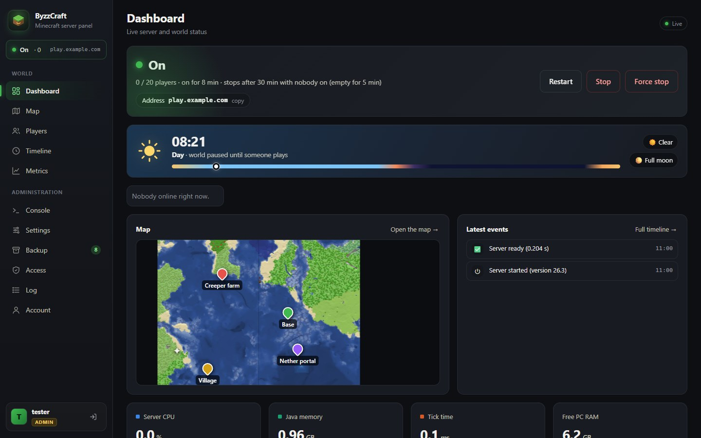
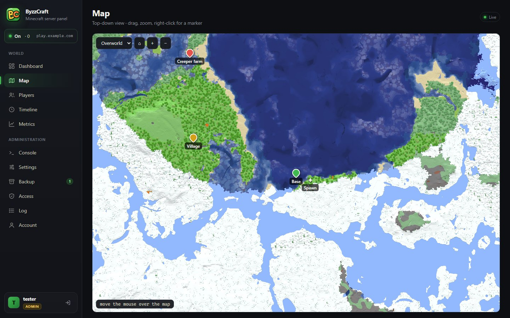
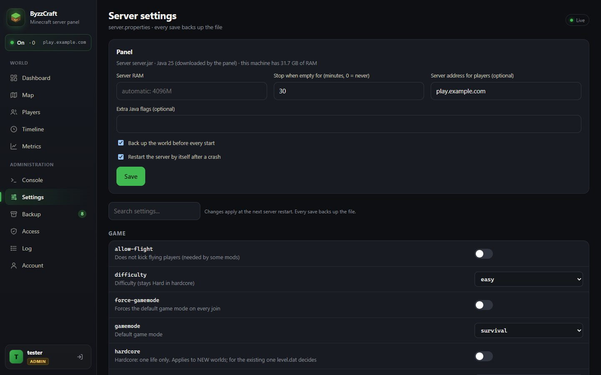
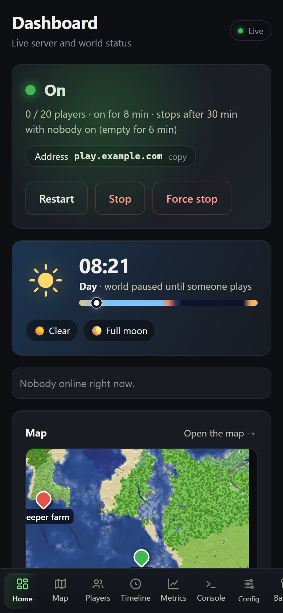

# ByzzCraft

[](https://github.com/muntalgk/byzzcraft/actions/workflows/tests.yml)

Pannello web self-hosted per un server Minecraft Java (vanilla, Paper o Fabric). Accendi il server dal
telefono, guarda chi è online e dove si trova, controlla l'inventario, fai il backup del mondo. Solo la
libreria standard di Python: nessuna dipendenza, nessun database. Legge i file del server e gli parla via RCON.

[Read me in English](README.md)

<p align="center">
  
  
</p>
<p align="center">
  
  
</p>

## Cosa fa

- **Accendi, spegni, riavvia** il server dal browser; si spegne da solo quando nessuno gioca da un po'.
- **Dashboard dal vivo**: giocatori online, ora del giorno, luna e meteo, CPU, RAM, tempo per tick, heap Java.
- **Mappa**: vista dall'alto del mondo esplorato (Overworld, Nether, End), posizioni dei giocatori, segnaposti condivisi.
- **Giocatori**: skin 3D, vita, fame, armatura, esperienza, inventario ed ender chest, statistiche.
- **Timeline**: sessioni di gioco, morti, progressi e chat, ricostruiti dai log del server.
- **Console**: log dal vivo e comandi RCON.
- **Impostazioni**: editor di `server.properties` che salva una copia del file a ogni modifica.
- **Backup**: backup del mondo manuali e programmati, conservazione, download, ripristino.
- **Accessi**: whitelist, operatori, ban ed espulsioni, anche a server spento.
- **Account**: ogni amico ha il suo login; gli admin vedono tutto, i giocatori possono accendere il server e guardare.
- Interfaccia in inglese e italiano, Windows e Linux.

Può anche creare un server da zero: scarica `server.jar` da Mojang e Java da [Eclipse Temurin](https://adoptium.net)
se mancano. Server vanilla, Paper (e derivati) e Fabric li riconosce dal jar; se il tuo ha un nome strano imposta
`server_jar` in `data/panel-config.json`. Funziona con Minecraft Java 1.20.5 e successive, compreso il formato dei
mondi della 26.x e le cartelle separate di Nether ed End di Paper.

## Installazione

Serve **Python 3.10 o successivo**. Il resto (server Minecraft, Java, texture) lo può scaricare il pannello.

### Su un server senza schermo (Linux, via SSH)

```bash
git clone https://github.com/muntalgk/byzzcraft.git
cd byzzcraft
python3 panel.py
```

Senza git: `curl -L https://github.com/muntalgk/byzzcraft/archive/refs/heads/main.tar.gz | tar xz && cd byzzcraft-main`

Il pannello stampa un link con un codice di configurazione monouso:

```
ByzzCraft is not set up yet.
  From your computer open:  http://192.168.1.20:8765/?setup=Xy3...
```

Aprilo nel browser **del tuo computer**. La pagina chiede la cartella del server (o ne crea uno nuovo lì),
la lingua, il tuo utente admin, chi può aprire il pannello (solo questa macchina o la rete di casa) e se
accetti l'[EULA di Minecraft](https://aka.ms/MinecraftEULA). Senza codice la pagina non si apre, così nessun
altro sulla rete può prendersi l'admin. Se il link non si apre proprio, il firewall blocca la porta:
`sudo ufw allow 8765/tcp`. Link perso? `grep setup= data/logs/byzzcraft.log`.

Poi fai in modo che resti acceso quando chiudi SSH e dopo un riavvio (il comando stampa un'unit systemd per il
tuo utente e la tua cartella):

```bash
python3 panel.py service | sudo tee /etc/systemd/system/byzzcraft.service
sudo systemctl daemon-reload && sudo systemctl enable --now byzzcraft
```

Preferisci fare tutto da shell? Configura senza browser:

```bash
python3 panel.py setup ~/minecraft --admin alex --lang it --new-server --network --accept-eula
```

(Ci sono anche `--no-java` e `--help`; la password la chiede, oppure la legge da `PANEL_PASSWORD`.)

### Con Docker

```bash
git clone https://github.com/muntalgk/byzzcraft.git
cd byzzcraft
docker compose up -d
docker compose logs
```

Apri il link di configurazione dei log (contiene l'IP della macchina) e lascia `/minecraft` come cartella del server.
Il container usa la rete dell'host: su Linux funziona così. Su Docker Desktop (Windows/Mac) attivala in
Settings > Resources > Network (Docker Desktop 4.34 o successivo).
Il pannello scarica server e Java nei due volumi di `docker-compose.yml`. Per aggiornare:
`git pull && docker compose build --pull && docker compose up -d` (Minecraft viene fermato in modo pulito prima).

Server già esistente: mettilo in una cartella e montala al posto del volume, ad esempio `- ./minecraft:/minecraft`,
dopo `sudo chown -R 1000:1000 ./minecraft` (il container gira con uid 1000).
Se imposti un limite di memoria al container, imposta anche la RAM in **Impostazioni → Pannello** (la RAM automatica vede la memoria dell'host).

### Sul tuo PC (Windows o Linux con desktop)

```bash
git clone https://github.com/muntalgk/byzzcraft.git
cd byzzcraft
python panel.py
```

Apri <http://127.0.0.1:8765> sullo stesso PC: la configurazione si apre senza codice. Per avviarlo a ogni
accesso: `python panel.py service` (su Windows lo aggiunge a Esecuzione automatica, senza admin).
Se `python` non si trova, usa `py panel.py`. Senza git: "Code > Download ZIP" su GitHub e decomprimi.

### Dopo la configurazione

Il pannello attiva RCON in `server.properties` e scarica le texture e i nomi che mostra (sono di Mojang,
quindi non stanno nel repository). Se manca ancora qualcosa (Java, EULA) la **Dashboard** lo mostra con un
pulsante per sistemarlo. Premi **Accendi**.

**Amici**: apri **Account** e aggiungi un utente per ognuno. Gli admin possono usare anche console,
impostazioni, backup e accessi. Per farli entrare in gioco apri la porta di Minecraft: `sudo ufw allow 25565/tcp`
(su Windows: consenti Java quando Windows lo chiede, oppure da un terminale come amministratore
`netsh advfirewall firewall add rule name="Minecraft" dir=in action=allow protocol=TCP localport=25565`),
e inoltrala sul router se giocano da fuori casa.

### Come parte il server

Il pannello avvia Java da solo, con i [flag di Aikar](https://docs.papermc.io/paper/aikars-flags), e fa il backup
del mondo prima di ogni avvio (`backups/world_*.zip`, dopo aver controllato lo spazio libero). RAM (automatica:
metà della macchina, da 512 MB a 4 GB, mai più dell'80% di quella libera), flag Java in più, backup prima dell'avvio, spegnimento automatico e indirizzo
per i giocatori stanno in **Impostazioni → Pannello**: si cambiano dal browser, senza SSH.

Ti serve qualcosa che il pannello non fa? Metti un tuo script nella cartella del server e imposta
`start_script` in `data/panel-config.json`: il pannello lo esegue e gli passa `JAVA` (il suo Java, se ne ha
scaricato uno), `SERVER_JAR` e `PYTHON`. Gli esempi sono in `examples/`.

## Raggiungerlo da altri dispositivi

"La mia rete di casa" nella configurazione apre il pannello su `http://<ip-del-server>:8765`, senza HTTPS: va
bene in casa, non su internet. Per il resto lascia "solo questa macchina" e scegli uno di questi:

### Tailscale (il più semplice, privato)

Installa [Tailscale](https://tailscale.com) sul server e sui tuoi dispositivi, poi sul server:

```bash
sudo tailscale serve --bg --https=443 http://127.0.0.1:8765
```

Il pannello è su `https://<macchina>.<tailnet>.ts.net`, solo per i dispositivi della tua tailnet, con HTTPS.
Gli amici possono entrare nella tua tailnet, oppure puoi [condividere la macchina](https://tailscale.com/kb/1084/sharing).

### nginx (dominio tuo)

Fai puntare un dominio al server, apri le porte 80 e 443, copia `examples/nginx.conf` e prendi un certificato
con certbot: i comandi sono nei commenti del file. Lascia `proxy_buffering off`: serve per gli aggiornamenti dal vivo.

### Caddy (dominio tuo, HTTPS automatico)

Fai puntare un dominio al server, apri le porte 80 e 443 e avvia Caddy con `examples/Caddyfile`. Il
certificato lo prende Caddy da solo.

### Tunnel SSH (nessuna configurazione)

`ssh -L 8765:127.0.0.1:8765 tu@tuo-server`, poi apri <http://127.0.0.1:8765> sul tuo computer.

Con nginx o Caddy il pannello è su internet: usa password lunghe. I login hanno un limite (5 tentativi, poi 15
minuti di blocco). Il proxy deve girare sulla stessa macchina del pannello.

## Log

| File | Cosa contiene |
|---|---|
| `data/logs/byzzcraft.log` | log tecnico del pannello: avvio, download, errori con traceback (a rotazione, 5 × 1 MB) |
| `data/logs/server-start.log` | output di Java (o del tuo script di avvio), solo l'ultimo: perché Minecraft non è partito |
| `data/panel.log` | chi ha fatto cosa nel pannello (tab **Registro**) |
| `<server>/logs/latest.log` | il log di Minecraft (tab **Console**) |

Gli admin leggono i primi due anche nel tab **Registro**, senza SSH. Comandi utili:

```bash
journalctl -u byzzcraft -f                          # il pannello, quando gira come servizio
tail -f data/logs/byzzcraft.log data/logs/server-start.log    # lo stesso, dai file
sudo systemctl restart byzzcraft                    # riavvia il pannello (Minecraft resta acceso)
python3 panel.py passwd NOME                        # password dimenticata
python3 panel.py java                               # scarica il Java che serve a server.jar
python3 panel.py assets                             # riscarica texture e nomi
```

## Aggiornare

```bash
cd byzzcraft && git pull && sudo systemctl restart byzzcraft
```

Su Windows: `git -C <cartella del pannello> pull`, poi riavvia il pannello. Un pannello avviato all'accesso gira
come `pythonw.exe`: fermalo prima da Gestione attività.

Docker: `git pull && docker compose build --pull && docker compose up -d` (Minecraft viene fermato in modo pulito prima).

Impostazioni, utenti, backup e cache della mappa restano: stanno in `data/`, non nel repository (con `BYZZ_DATA`
li tieni altrove). Le installazioni di prima della 1.0 li hanno accanto al codice e continuano a funzionare così. Quando esce una nuova
release la Dashboard lo dice agli admin, con questo comando; la versione che usi è in fondo alla pagina **Account**.

Backup e ripristini controllano prima lo spazio libero e si fermano con un messaggio invece di riempire il disco;
la Dashboard avvisa quando non ci stanno più tre backup.

## Configurazione

`data/panel-config.json` lo scrive la configurazione iniziale; puoi modificarlo e riavviare il pannello. Le chiavi
sono descritte nel [README inglese](README.md#configuration).

## Problemi

La Dashboard elenca cosa manca e, quando il server non parte, dice perché. Se non basta,
`data/logs/server-start.log` ha l'output completo.

- **"RCON non disponibile"**: riavvia una volta il server Minecraft dopo la configurazione, così legge RCON.
  Se il server era già acceso durante la configurazione, scrivi `stop` una volta nella sua console (il pannello
  non può ancora fermarlo), poi avvialo dal pannello.
- **Porta 8765 occupata**: c'è già un pannello acceso, oppure cambia `port` in `data/panel-config.json`.
- **Non avviarlo da root**: i file del server diventerebbero di root. Il pannello lo segnala nel log.

## Rete e privacy

Il pannello parla solo con questi servizi, e solo per scaricare; non invia dati su di te o sul tuo server:

| Servizio | Quando | A cosa serve |
|---|---|---|
| Mojang (`piston-meta`, `piston-data`) | setup, `panel.py assets`, server nuovo | jar del server, elenco versioni, texture e nomi |
| Mojang (`sessionserver`, `textures.minecraft.net`, `api.mojang.com`) | apri la pagina di un giocatore, whitelist a server spento | skin e UUID (skin in cache per 6 ore) |
| Adoptium (`api.adoptium.net`, files on GitHub) | manca Java | download di Java |
| GitHub (`api.github.com`) | una volta al giorno | c'è una release nuova? (`update_check: false` lo spegne) |

## Contribuire

I test girano con `for t in tests/test_*.py; do python3 "$t"; done` e su GitHub Actions (Ubuntu e Windows).
Prima di una pull request leggi [CONTRIBUTING.md](CONTRIBUTING.md).

## Licenza

MIT, vedi [LICENSE](LICENSE).

NON È UN PRODOTTO UFFICIALE DI MINECRAFT. NON APPROVATO DA MOJANG O MICROSOFT NÉ ASSOCIATO A ESSI.
